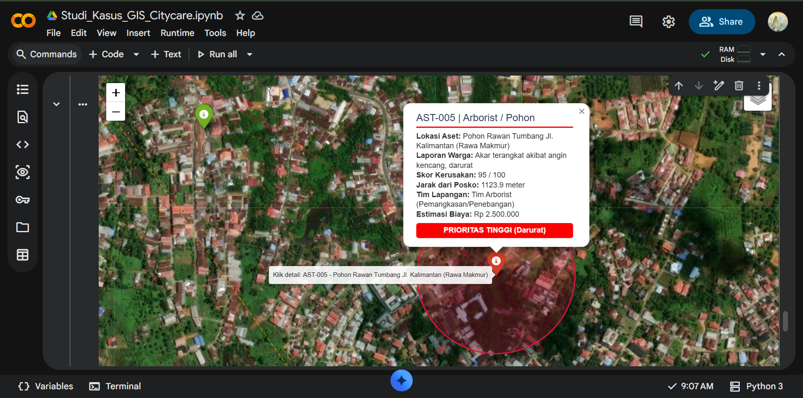

# Studi Kasus GIS: Sistem Monitoring Aset Kota & Otomasi Prioritas Laporan Publik ("Mini Snap Send Solve")

Repositori ini merupakan implementasi studi kasus dan pemrograman geospasial untuk memenuhi tugas **Informatics Practitioner Lecture Series 2026** Program Studi Informatika Universitas Bengkulu.

**Referensi Materi Kuliah Umum:** *Carrier and Competition in Industrial Era with GIS (Industry Perspective: How Bachelor of IT Leads to Career in GIS)*
**Narasumber:** Bapak Widi Prima Deva, S.T. (*Asset Management – GIS Analyst* di Citycare Property, Christchurch, Selandia Baru)

---

## 1. Latar Belakang & Deskripsi Studi Kasus

Dalam pemaparan materi kuliah umum, Bapak Widi Prima Deva menjelaskan bagaimana pengelolaan fasilitas publik dan tata kota di Christchurch, Selandia Baru dilakukan secara terintegrasi antara pemerintah kota (*City Council*), perusahaan pengelola aset (**Citycare Property**), dan partisipasi masyarakat melalui sistem pelaporan berbasis lokasi (**Snap Send Solve**).

Ketika masyarakat menemukan aset kota yang rusak atau membahayakan—seperti pohon miring yang rawan tumbang, fasilitas taman yang rusak, atau rumput tepi jalan (*berm*) di depan rumah warga lansia yang membutuhkan pemeliharaan—mereka mengirimkan laporan ber-geotag (koordinat GPS). Selanjutnya, **GIS Analyst** melakukan *data capture*, *post-processing*, dan analisis spasial untuk menentukan:
1. Tingkat urgensi penanganan darurat (*Data-Driven Decision Making*).
2. Jarak lokasi aset terhadap posko tim pemeliharaan (*spatial distance calculation*).
3. Alokasi tim lapangan (seperti *Tim Arborist* untuk pemangkasan pohon) beserta estimasi anggaran perbaikannya.

Melalui proyek ini, keunggulan lulusan **Teknik Informatika** sebagai pengembang sistem (*GIS Developer*) diterapkan dengan membangun **alur kerja (*workflow*) otomasi analisis spasial menggunakan Python (`GeoPandas` & `Folium`)** untuk studi kasus simulasi di wilayah **Kota Bengkulu**.

---

## 2. Arsitektur Alur Kerja Sistem (System Workflow)

<pre>
[Input Data Laporan Warga (.csv)] 
       │  (Berisi Koordinat GPS Latitude/Longitude & Skor Kerusakan)
       ▼
[Konversi Data Spasial & Transformasi Proyeksi (GeoPandas)]
       │  • Mengubah koordinat menjadi geometri titik (Point)
       │  • Transformasi CRS dari WGS84 (EPSG:4326) ke UTM Zona 48S Bengkulu (EPSG:32748)
       ▼
[Analisis Spasial & Otomasi Keputusan (Post-Processing)]
       │  • Perhitungan jarak presisi (meter) tiap titik aset ke Posko Utama (Area UNIB)
       │  • Klasifikasi otomatis Status Prioritas, Penugasan Tim, & Estimasi Anggaran
       │  • Pembentukan Buffer Zona Bahaya (Radius 150m) untuk aset berstatus Darurat
       ▼
[Output Standar Industri & Visualisasi WebGIS]
       ├── hasil_analisis_aset.geojson (Data pertukaran geospasial standar)
       ├── laporan_rekap_council.csv   (Rekapitulasi tabel anggaran & tindakan)
       └── webmap_manajemen_aset.html  (Peta WebGIS interaktif multi-layer & Citra Satelit Esri)
</pre>

---

## 3. Preview Visualisasi WebGIS Interaktif

Berikut adalah tampilan hasil implementasi **WebGIS Manajemen Aset Kota** yang dilengkapi dengan lapisan **Citra Satelit Resolusi Tinggi (Esri World Imagery)**, visualisasi **Radius Zona Bahaya (150 meter)** pada pohon rawan tumbang, garis rute jarak ke Posko Utama, serta kartu informasi atribut (*popup*) interaktif:

> **Catatan:** Untuk mencoba peta secara interaktif (melakukan *zoom*, mengganti layer peta jalan/satelit, dan mengklik setiap titik aset), silakan unduh dan buka file **`webmap_manajemen_aset.html`** melalui *browser*.

---

## 4. Hasil Analisis Spasial & Otomasi Prioritas

Berdasarkan hasil eksekusi algoritma analisis spasial menggunakan proyeksi metrik **UTM Zona 48S (`EPSG:32748`)** dengan titik referensi Posko Utama di sekitar Kampus UNIB (`-3.7585, 102.2725`), diperoleh rekapitulasi keputusan otomatis sebagai berikut:

| ID Laporan | Nama & Lokasi Aset | Kategori | Skor | Jarak dari Posko (m) | Status Prioritas | Tim Penanganan | Estimasi Anggaran |
| :--- | :--- | :--- | :---: | :---: | :--- | :--- | :--- |
| **AST-001** | Pohon Pelindung Jl. WR Supratman (Dekat Gerbang UNIB) | Arborist / Pohon | 90 | 135.5 m | 🔴 **PRIORITAS TINGGI (Darurat)** | Tim Arborist (Pemangkasan/Penebangan) | Rp 2.500.000 |
| **AST-002** | Area Rumput (Berm) Simpang Kandang Limun | Berm / Rumput | 45 | 511.5 m | 🟢 **PRIORITAS RENDAH (Rutin)** | Tim Lanskap (Pemotong Rumput Kota) | Rp 500.000 |
| **AST-003** | Pohon Tua Depan Dekanat FT UNIB | Arborist / Pohon | 85 | 183.9 m | 🔴 **PRIORITAS TINGGI (Darurat)** | Tim Arborist (Pemangkasan/Penebangan) | Rp 2.500.000 |
| **AST-004** | Lampu & Bangku Taman Danau Dendam Tak Sudah | Fasilitas Taman | 65 | 4934.5 m | 🟠 **PRIORITAS SEDANG (Terjadwal)** | Tim Teknisi Fasilitas Publik | Rp 1.200.000 |
| **AST-005** | Pohon Rawan Tumbang Jl. Kalimantan (Rawa Makmur) | Arborist / Pohon | 95 | 1123.9 m | 🔴 **PRIORITAS TINGGI (Darurat)** | Tim Arborist (Pemangkasan/Penebangan) | Rp 2.500.000 |
| **AST-006** | Taman Bermain Publik Pantai Panjang | Fasilitas Taman | 40 | 6056.8 m | 🟢 **PRIORITAS RENDAH (Rutin)** | Tim Teknisi Fasilitas Publik | Rp 500.000 |
| **AST-007** | Area Rumput (Berm) Rumah Lansia Jl. Indragiri | Berm / Rumput | 50 | 4774.3 m | 🟢 **PRIORITAS RENDAH (Rutin)** | Tim Lanskap (Pemotong Rumput Kota) | Rp 500.000 |
| **AST-008** | Pohon Miring Dekat RSUD M. Yunus | Arborist / Pohon | 88 | 9131.4 m | 🔴 **PRIORITAS TINGGI (Darurat)** | Tim Arborist (Pemangkasan/Penebangan) | Rp 2.500.000 |

---

## 5. Struktur File dalam Repositori

* `Studi_Kasus_GIS_Citycare.ipynb` : *Source code* lengkap dalam format Jupyter Notebook / Google Colab.
* `data_laporan_aset_kota.csv` : Dataset input simulasi laporan masyarakat beserta koordinat GPS.
* `hasil_analisis_aset.geojson` : Output data spasial berstandar GeoJSON yang siap diimpor ke QGIS / ArcGIS Pro.
* `laporan_rekap_council.csv` : Output laporan tabel otomasi untuk pengajuan anggaran perbaikan kota.
* `webmap_manajemen_aset.html` : Output visualisasi peta WebGIS interaktif berbasis Folium/Leaflet.
* `preview_peta.png` : Dokumentasi visual antarmuka WebGIS.

---

## 6. Cara Menjalankan Kode

1. Buka file `Studi_Kasus_GIS_Citycare.ipynb` menggunakan **Google Colab** atau **Jupyter Notebook**.
2. Instal pustaka geospasial yang dibutuhkan melalui terminal atau *cell* pertama:
   <pre>pip install pandas geopandas folium shapely</pre>
3. Jalankan seluruh *cell* kode secara berurutan dari atas ke bawah untuk menghasilkan dataset, analisis spasial, dan file peta interaktif `.html`.
